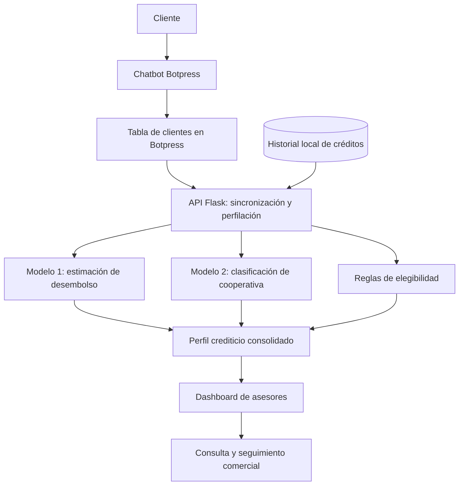
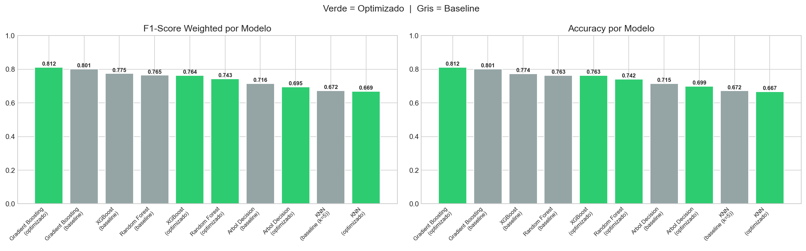
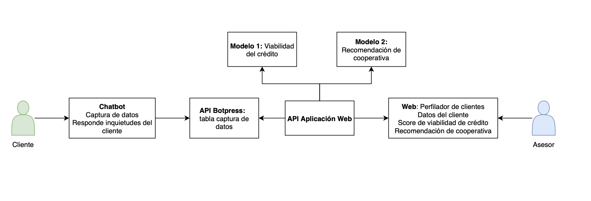
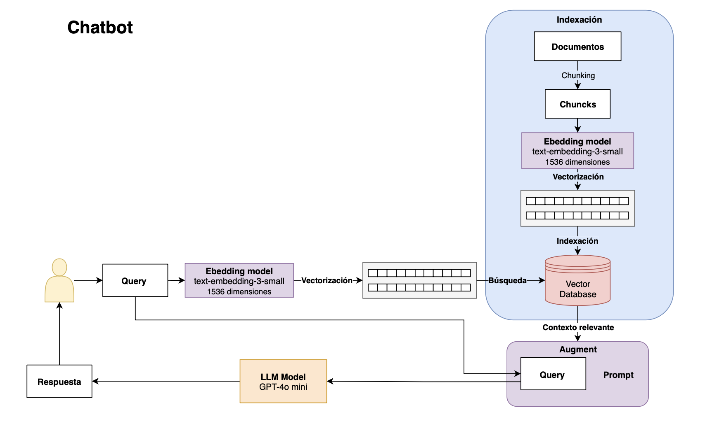
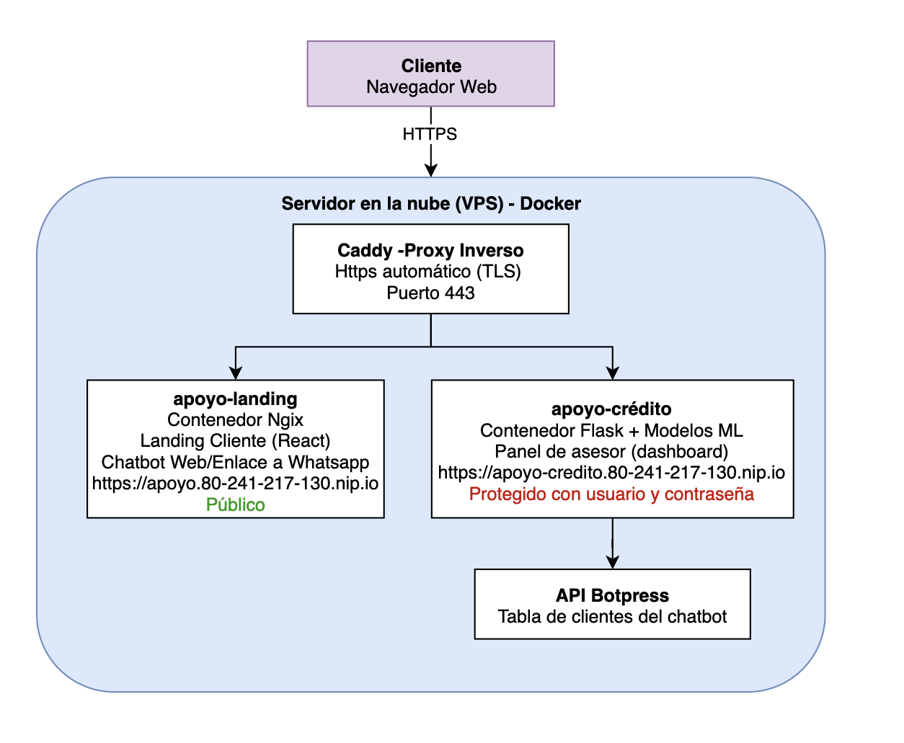

<div align="center">

# Proyecto IA – Apoyo Crediticio

### Sistema inteligente de perfilación de clientes y recomendación de cooperativas financieras

**Machine Learning · Inteligencia Artificial · Automatización · Analítica de Datos · Aplicación Web**


</div>

---

##  Descripción

**Proyecto IA – Apoyo Crediticio** es un prototipo de apoyo a la gestión comercial de créditos que integra un **chatbot de captura de información**, **modelos de aprendizaje automático**, **reglas de negocio**, una **API REST en Flask** y un **dashboard para asesores**.

Su propósito es facilitar la identificación de oportunidades crediticias y orientar la selección de cooperativas potencialmente compatibles con el perfil de cada cliente. El sistema utiliza información suministrada mediante Botpress y, cuando está disponible, un historial local de operaciones crediticias.

> **Alcance:** las probabilidades son estimaciones de modelos entrenados con datos históricos, no garantías de desembolso ni decisiones oficiales de aprobación. Este proyecto es una herramienta de apoyo y demostración, no un sistema autónomo de otorgamiento de crédito.

##  Problema y objetivos

En los procesos de asesoría crediticia, la revisión manual de perfiles y condiciones entre múltiples cooperativas puede requerir tiempo y dificultar la priorización de oportunidades comerciales.

Este proyecto busca:

- **Automatizar la recopilación de datos** de potenciales clientes mediante un chatbot.
- **Estimar un indicador predictivo** relacionado con el desembolso de créditos a partir de información histórica.
- **Ordenar cooperativas** según la compatibilidad predictiva con el perfil del solicitante.
- **Aplicar criterios de elegibilidad** definidos como reglas de negocio para complementar las predicciones.
- **Centralizar la información** en un panel para consulta, seguimiento y asignación de asesores.

## ¿Cómo funciona?



**Flujo resumido:**

1. El usuario comparte sus datos de interés crediticio a través de Botpress.
2. La aplicación consulta la tabla de clientes de Botpress o, si falla la conexión, intenta recuperar la información guardada localmente.
3. Se consulta el historial del cliente en la base de datos Excel, si existe.
4. El primer modelo calcula una estimación de probabilidad de desembolso.
5. El segundo modelo genera un ranking de cooperativas y se contrastan sus resultados con reglas de negocio.
6. Los resultados se presentan mediante una API y un panel web para asesores.

## Funcionalidades implementadas

### 1. Perfilación predictiva
- Cálculo de una probabilidad estimada de desembolso.
- Uso de variables como edad, monto solicitado, plazo e historial de créditos.
- Ordenamiento de los perfiles procesados según la probabilidad estimada.

### 2. Recomendación de cooperativas
- Ranking de cooperativas a partir de probabilidades por clase del modelo.
- Reglas de elegibilidad basadas en edad, monto, plazo, tipo de crédito y pagaduría.
- Identificación de una opción elegible entre las alternativas calculadas.
- Visualización de las razones por las que una opción no cumple una regla.

### 3. Chatbot integrado con Botpress
- Recopilación de datos para alimentar la perfilación.
- Consulta de registros por API de Botpress.
- Persistencia local de respaldo en formato JSON.

### 4. Dashboard de asesores
- Visualización de clientes y resultados de perfilación.
- Búsqueda por nombre o identificación.
- Filtros relacionados con la gestión comercial.
- Cierre y reapertura de registros.
- Asignación de asesores mediante la API (almacenada en memoria del proceso).

## Tecnologías utilizadas

| Capa | Tecnologías | Uso principal |
|---|---|---|
| Ciencia de datos | Python, Pandas, NumPy, Jupyter Notebook | Preparación, análisis y experimentación |
| Machine Learning | scikit-learn, XGBoost, imbalanced-learn | Entrenamiento y evaluación de modelos |
| Backend | Flask, Flask-CORS | API REST y servicios de perfilación |
| Integración | Botpress, Requests | Chatbot y consulta de registros |
| Frontend | HTML, CSS, JavaScript | Panel web para asesores |
| Persistencia | Excel, CSV, JSON | Información histórica y respaldo local |
| Modelos serializados | Joblib, Pickle | Carga de artefactos entrenados |

## Modelos de Machine Learning

### Modelo 1: estimación del desembolso

**Objetivo:** clasificar registros históricos como `DESEMBOLSADO` o `NO_DESEMBOLSADO` y proporcionar una probabilidad estimada de la clase positiva.

**Variables utilizadas por la API:**

- `dias_desde_ultimo_credito`
- `MONTO`
- `PLAZO`
- `num_creditos_totales`
- `EDAD_AL_PRESTAMO`

En el notebook se exploraron **Random Forest, XGBoost y SVM**, además de variantes para abordar el desbalance de clases mediante **SMOTE**, pesos de clase y ajustes de umbral. El análisis destaca la importancia de evaluar el desempeño por clase y no únicamente la exactitud global.

| Experimento documentado en el notebook | Accuracy | F1 clase no desembolsado | F1 clase desembolsado |
|---|---:|---:|---:|
| Random Forest inicial (umbral 0.6) | 0.80 | 0.35 | 0.88 |
| Random Forest con SMOTE, variante 2 (umbral 0.6) | 0.75 | 0.44 | 0.84 |
| Random Forest con SMOTE, variante 3 (umbral 0.5) | 0.73 | 0.46 | 0.82 |

**Interpretación:** la variante 3 mejora la identificación de la clase minoritaria respecto del modelo inicial, aunque reduce la exactitud global. Las métricas anteriores provienen de las ejecuciones guardadas en `notebooks/modelo1_mejorado.ipynb`.



### Modelo 2: recomendación de cooperativas

**Objetivo:** clasificar la cooperativa asociada a perfiles crediticios según las características del solicitante.

**Variables de entrada de la API:** edad, monto, plazo, tipo de crédito y pagaduría.

Se compararon **árbol de decisión, Random Forest, Gradient Boosting, KNN y XGBoost**. En los resultados registrados en el notebook, el mejor experimento fue **Gradient Boosting optimizado**.

| Métrica | Resultado del experimento |
|---|---:|
| Accuracy en test | **0.8118** |
| F1 ponderado en test | **0.8124** |
| F1 ponderado, validación cruzada repetida | **0.8014 ± 0.0081** |
| F1 macro, validación cruzada repetida | **0.8225 ± 0.0072** |

La validación cruzada repetida documentada utiliza **10 semillas × 5 particiones**. Los resultados corresponden a los experimentos guardados en `notebooks/modelo2_mejorado.ipynb`, no a una auditoría independiente del sistema desplegado.

> **Nota sobre el artefacto:** el archivo de producción se llama `modelo2_XGBoost.pkl`, pero el notebook guarda un *bundle* con varios modelos y el campo `mejor_modelo`. Por lo tanto, **el nombre del archivo no significa necesariamente que XGBoost sea el modelo seleccionado**.

### Reglas de negocio

Las recomendaciones se complementan con restricciones codificadas para las cooperativas, por ejemplo:

- Límites de edad.
- Montos mínimos.
- Plazos de crédito.
- Condiciones relacionadas con la pagaduría y la categoría de crédito.

Estas reglas son condiciones implementadas en el prototipo y **no deben interpretarse como políticas vigentes de entidades financieras sin validación externa**.

## Estructura del repositorio

```text
Proyecto-IA-Apoyo-Crediticio-main/
├── chatbot_botpress/
│   └── Chatbot AC.bpz                 # Exportación del chatbot
├── data/
│   ├── bd_IA.xlsx                     # Base histórica (revisar privacidad)
│   └── dataset_limpio.csv             # Datos preparados
├── documentos/
│   ├── diagrama_arquitectura_RAG.png
│   ├── diagrama_despliegue.png
│   ├── diagrama_solucion.png
│   ├── diagrama_modelo1_arbol.png
│   ├── diagrama_modelo1_random_forest.jpeg
│   ├── diagrama_modelo 2_arbol_gradient_boosting.png
│   └── knowledge_base_chatbot/
├── notebooks/
│   ├── EDA.ipynb
│   ├── modelo1_mejorado.ipynb
│   ├── modelo2_mejorado.ipynb
│   └── imagenes/
├── web_app/
│   ├── api/API_model.py               # Endpoints y lógica de inferencia
│   ├── bd/bd_IA.xlsx
│   ├── data/clientes_data.json        # Respaldo de clientes (revisar privacidad)
│   ├── modelos/
│   │   ├── modelo1_random_forest.pkl
│   │   └── modelo2_XGBoost.pkl
│   ├── public/
│   │   ├── dashboard.html
│   │   ├── css/dashboard.css
│   │   └── js/dashboard.js
│   ├── utils/botpress_handler.py
│   ├── config.py
│   ├── example.env
│   ├── requirements.txt
│   └── run.py
└── requirements.txt
```

## Diagramas del proyecto

### Arquitectura documentada


La arquitectura del sistema se diseñó de forma modular, separando la captura de información, el procesamiento de datos y la visualización de resultados. Esta organización permite que los componentes funcionen de manera independiente y facilita su mantenimiento o actualización. Además, la aplicación web actúa como punto de integración entre los modelos predictivos y la información recopilada, permitiendo centralizar la lógica de negocio sin depender directamente de la interfaz del chatbot.

### Integración del chatbot


Para complementar la captura de información, se diseñó una arquitectura de generación aumentada por recuperación (RAG), orientada a responder consultas utilizando una base de conocimiento documental. Este enfoque contempla la fragmentación de documentos, su transformación en representaciones vectoriales mediante embeddings y la recuperación de contenido relevante para enriquecer las respuestas del modelo de lenguaje. El diagrama representa el diseño de esta integración, cuya configuración conversacional se encuentra asociada al chatbot desarrollado en Botpress.

### Despliegue


El despliegue se planteó mediante una infraestructura contenerizada que permite separar la interfaz pública del entorno de trabajo de los asesores. Se utiliza un proxy inverso para gestionar el acceso HTTPS y dirigir las solicitudes hacia los servicios correspondientes. Esta distribución busca facilitar la administración de los componentes y establecer diferentes niveles de acceso, manteniendo el portal de clientes disponible públicamente y restringiendo el acceso al panel de gestión crediticia.

## Instalación y ejecución local

### Requisitos previos

- Python 3.11 o superior, dentro de versiones compatibles con las dependencias.
- `pip` y un entorno virtual.
- Credenciales de Botpress si se desea sincronización en tiempo real.
- Archivos locales de datos y modelos disponibles en las rutas indicadas.

### Paso 1. Clonar el repositorio

```bash
git clone <URL_DE_TU_REPOSITORIO>
cd Proyecto-IA-Apoyo-Crediticio-main
```

Sustituye `<URL_DE_TU_REPOSITORIO>` por la URL real de GitHub.

### Paso 2. Crear y activar un entorno virtual

**Windows (PowerShell):**

```powershell
python -m venv .venv
.\.venv\Scripts\Activate.ps1
```

**Linux / macOS:**

```bash
python3 -m venv .venv
source .venv/bin/activate
```

### Paso 3. Instalar dependencias

```bash
python -m pip install -r web_app/requirements.txt
```

Para **reproducir los notebooks**, podrían necesitarse dependencias de experimentación adicionales, como `jupyter`, `matplotlib`, `seaborn` e `imbalanced-learn`, que no están todas declaradas en el archivo de requisitos de la aplicación.

### Paso 4. Configurar variables de entorno

Crea un archivo `.env` en `web_app/` tomando como referencia `web_app/example.env` y coloca allí los valores de tu entorno, especialmente los identificadores y token de Botpress.

```env
BOTPRESS_TOKEN=tu_token
BOTPRESS_WORKSPACE_ID=tu_workspace_id
BOTPRESS_BOT_ID=tu_bot_id
BOTPRESS_TABLE_NAME=tu_table_id

FLASK_ENV=development
FLASK_SECRET_KEY=una_clave_segura_generada_por_ti
HOST=127.0.0.1
PORT=5001

DATA_DIR=./data
CLIENTES_FILE=clientes_data.json
CORS_ENABLED=true
ALLOWED_ORIGINS=http://127.0.0.1:5001
```

**Importante:** estas variables son un ejemplo. El sistema utiliza rutas relativas y las rutas de los modelos y del archivo Excel se definen en `web_app/config.py`. No subas el archivo `.env` al repositorio.

### Paso 5. Ejecutar la aplicación

Desde la raíz del repositorio:

```bash
cd web_app
python run.py
```

Abre en el navegador:

**http://127.0.0.1:5001/**

Para comprobar que la API responde:

```bash
curl http://127.0.0.1:5001/health
```

**Nota:** la carga de perfiles reales mediante `POST /api/perfilar_cliente` depende de contar con una tabla accesible en Botpress o registros locales de respaldo. El dashboard puede mostrar resultados distintos si no existen dichos datos.

## API REST

| Método | Endpoint | Descripción |
|---|---|---|
| `GET` | `/health` | Verificar disponibilidad de la aplicación |
| `POST` | `/api/perfilar_cliente` | Sincronizar clientes y ejecutar la perfilación |
| `GET` | `/api/clientes` | Listar clientes; admite `?solo_activos=true` |
| `POST` | `/api/cliente/<cedula>/cerrar` | Marcar cliente como cerrado |
| `POST` | `/api/cliente/<cedula>/abrir` | Reabrir cliente |
| `POST` | `/api/cliente/<cedula>/asesor` | Asignar asesor al cliente |
| `GET` | `/api/asesores` | Consultar asignaciones de asesores en memoria |

Ejemplo de perfilación (una vez configurada la fuente de clientes):

```bash
curl -X POST http://127.0.0.1:5001/api/perfilar_cliente
```

La respuesta incluye el estado, el total de clientes procesados y, para cada uno, el resultado predictivo, ranking de cooperativas, opción elegible e historial consultado.

## Análisis y documentación

- **Análisis exploratorio:** [`notebooks/EDA.ipynb`](notebooks/EDA.ipynb)
- **Modelo de desembolso:** [`notebooks/modelo1_mejorado.ipynb`](notebooks/modelo1_mejorado.ipynb)
- **Modelo de cooperativas:** [`notebooks/modelo2_mejorado.ipynb`](notebooks/modelo2_mejorado.ipynb)
- **Documentación gráfica:** [`documentos/`](documentos/)
- **Chatbot exportado:** [`chatbot_botpress/`](chatbot_botpress/)

## Limitaciones y siguientes pasos

Como prototipo académico, el proyecto tiene oportunidades de mejora relevantes:

1. **Privacidad y seguridad:** sustituir datos personales por datos sintéticos o anonimizados antes de publicar; mantener credenciales fuera del repositorio.
2. **Consistencia de artefactos:** verificar que los modelos `.pkl` publicados correspondan exactamente a las versiones finales evaluadas en los notebooks.
3. **Reproducibilidad:** unificar y fijar dependencias de entrenamiento e inferencia; incluir pruebas automatizadas.
4. **Persistencia:** migrar estados y asignaciones actualmente almacenados en JSON o memoria a una base de datos apropiada.
5. **Validación del negocio:** revisar las reglas con fuentes autorizadas, actualizarlas y validar resultados con datos externos.
6. **Uso responsable de IA:** evaluar calibración, sesgos, desempeño por grupos y revisión humana para decisiones que afecten a las personas.
7. **Seguridad de la API:** incorporar autenticación, autorización, controles de acceso y manejo seguro de información personal antes de una implementación real.

## Créditos

Proyecto desarrollado con fines académicos y de demostración, integrando técnicas de ciencia de datos, machine learning y desarrollo de aplicaciones.

**Autoría y equipo:** Nicolás Guarán, Estefania Hernández, Natalia Paredes y Mariana Cifuentes.
---

<div align="center">

**De los datos a decisiones mejor informadas: analítica predictiva y automatización para la gestión crediticia.**

</div>
